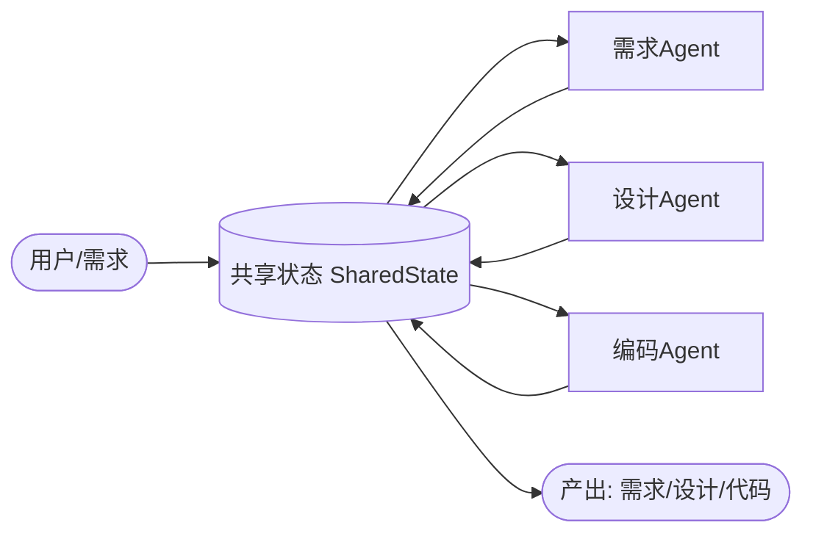

# Doubao Multi-Agent Workflow — 跑在火山方舟豆包大模型上的三智能体协作流水线

本项目用 3 个 Agent 协作完成需求、设计、编码的迷你软件工程流程，通过共享状态（黑板）实现 Agent 间通信。三个 Agent 统一接入**火山方舟（Volcano Ark）**的**豆包大模型 Doubao-Seed-2.1-pro**，通过不同的系统提示词区分角色。

## 1. 项目目标

实现一条完整的 **Mini SE 流程**：

```
需求 Agent  →  设计 Agent  →  编码 Agent
（需求文档）   （技术设计）    （代码骨架）
```

- 3 个 Agent 协作完成完整流程 ✅
- Agent 间消息传递 / 状态共享 ✅（共享状态黑板 + 通信日志）
- 基本流程控制（顺序执行）✅（`Workflow.run` 顺序编排）
- 未配置 API Key 时自动降级 mock 模板，无需任何配置即可跑通流程 ✅

## 2. 架构与流程图



- **共享状态（Blackboard）**：`state.py` 提供 `publish`/`read`/`history`。
- 上游 Agent 把结果 `publish` 到共享状态；
- 下游 Agent 通过 `read` 获取上游产物，完成 **Agent 间信息互通**；
- `history` 记录完整通信链路，满足「执行日志与状态追踪」。
- **统一调用层**：`llm.py` 的 `LLMClient` 抽象了模型调用，通过 OpenAI 兼容接口接入火山方舟；超时与自动重试（网络抖动/超时重试 3 次）已内置。

## 3. 引擎与角色

| #    | Agent      | 引擎            | 模型 ID                      | 所需 Key（环境变量） |
| ---- | ---------- | --------------- | ---------------------------- | -------------------- |
| 1    | 需求 Agent | 火山方舟 · 豆包 | `doubao-seed-2-1-pro-260915` | `ARK_API_KEY`        |
| 2    | 设计 Agent | 火山方舟 · 豆包 | `doubao-seed-2-1-pro-260915` | `ARK_API_KEY`        |
| 3    | 编码 Agent | 火山方舟 · 豆包 | `doubao-seed-2-1-pro-260915` | `ARK_API_KEY`        |

设计决策：**单模型、多角色**。多智能体的协作性来自角色分工（独立的 Agent 类与系统提示词）、共享状态与流程编排，而不是模型个数；三个 Agent 共用同一旗舰模型，靠提示词区分需求 / 设计 / 编码职责。后续迭代计划按角色分档（见第 7 节路线图）。

> 若 `ARK_API_KEY` 未配置，三个 Agent 会自动降级为 mock 模板，流程仍能跑通。

## 4. 使用方法

```
# 1. 安装依赖
pip install -r requirements.txt

# 2. 配置 Key：复制 .env.example 为 .env，填入火山方舟的 API Key
#    （火山引擎控制台 -> 火山方舟 -> API Key 管理 中创建）

# 3. 运行
python main.py
```

运行时首先进行**环境检测**：检查 `ARK_API_KEY` 是否设置；已设置则三个 Agent 使用真实模型生成内容，未设置则自动降级为 mock 模板并给出提示。

运行后根据提示**输入一段产品需求描述**（回车使用默认示例需求），三个 Agent 将依次运行，完整产出直接输出在终端：需求文档 → 技术设计 → 代码骨架。

> 性能提示：Doubao-Seed-2.1-pro 为深度思考型旗舰模型，生成整篇文档较慢，单个 Agent 约需 1–4 分钟，整轮流程约 5–10 分钟；`llm.py` 的请求超时已设为 600 秒，请耐心等待，不要中途中断。
> >
> 连通性自检：可先运行 `python test_ark.py`，打印出豆包的真实回复即表示 Key 与模型配置无误。

### 运行实测示例（2026-11-18，真实模型端到端跑通）

**输入需求描述：**

```
宠物喂食提醒小程序
```

**终端过程（节选）：**

```
环境检测（3 个 Agent 的真实引擎）：
  豆包（doubao-seed-2-1-pro）（ARK_API_KEY）: 已设置 -> 将使用真实模型 doubao-seed-2-1-pro-260915
  豆包（doubao-seed-2-1-pro）（ARK_API_KEY）: 已设置 -> 将使用真实模型 doubao-seed-2-1-pro-260915
  豆包（doubao-seed-2-1-pro）（ARK_API_KEY）: 已设置 -> 将使用真实模型 doubao-seed-2-1-pro-260915

>>> 步骤：运行 需求Agent（引擎：豆包（doubao-seed-2-1-pro） / doubao-seed-2-1-pro-260915）
>>> 步骤：运行 设计Agent（引擎：豆包（doubao-seed-2-1-pro） / doubao-seed-2-1-pro-260915）
>>> 步骤：运行 编码Agent（引擎：豆包（doubao-seed-2-1-pro） / doubao-seed-2-1-pro-260915）

Workflow 完成：3 个 Agent 已通过共享状态完成信息互通。
流程结束：需求Agent -> 设计Agent -> 编码Agent 已通过共享状态完成信息互通。
```

三个 Agent 的产出（需求文档、技术设计、三层架构代码骨架）均由豆包真实生成，并通过共享状态逐级传递、互为上下文。

## 5. 文件结构

```
doubao-multi-agent-workflow
├── llm.py                  # 统一 LLM 客户端（mock + OpenAI 兼容平台，含超时重试）
├── state.py                # 共享状态 / 消息通信（Blackboard）
├── agents.py               # 3 个 Agent：需求 / 设计 / 编码
├── workflow.py             # 顺序流程编排
├── main.py                 # 入口（含环境检测、平台配置 PLATFORMS）
├── test_ark.py             # 火山方舟连通性测试（最小真实调用）
├── test_workflow.py        # 自动化测试（12 项检查）
├── run_test.bat            # 一键运行测试（Windows）
├── sample_requirements.txt # 示例需求描述
├── requirements.txt
├── .env.example            # 密钥模板（复制为 .env 后填入自己的 Key）
├── docs/
│   ├── Design.md           # 设计文档（架构 / 流程图 / Agent 设计 / 技术选型）
│   └── TEST.md             # 测试文档（方法 + 测试数据 + 判定）
├── PRD.md                  # 产品需求文档（一页）
└── README.md
```

> 安全提示：`.env` 含密钥，已加入 `.gitignore`，切勿提交到公开仓库。

## 6. 设计要点

| 维度       | 实现情况                                                     |
| ---------- | ------------------------------------------------------------ |
| 流程完整性 | Mini SE 流程端到端跑通：需求描述 → 需求 → 设计 → 代码        |
| Agent 协作 | 3 个 Agent 通过共享状态互通，通信链路由 `history` 记录       |
| 可扩展性   | 新增 Agent 只需继承 `BaseAgent` 并加入 `Workflow.agents`；引擎通过 `PLATFORMS` 配置切换，无需改动 Agent 代码 |
| 文档       | 本 README + docs/ 设计与测试文档                             |

## 7. 路线图

- **按角色分档选模型**：需求 / 设计 Agent 改用 turbo / lite 档位降本提速，编码 Agent 保留 pro 保质量（`PLATFORMS` 改配置即可）。
- **流式输出**：把非流式请求改为流式，长文档边生成边显示，不再长时间白屏等待。
- **Web 界面**：在浏览器里输入需求、实时查看三个 Agent 的产出与通信链路。
- **效果评估页**：对多次运行的产出做对比与打分，沉淀评估数据。
